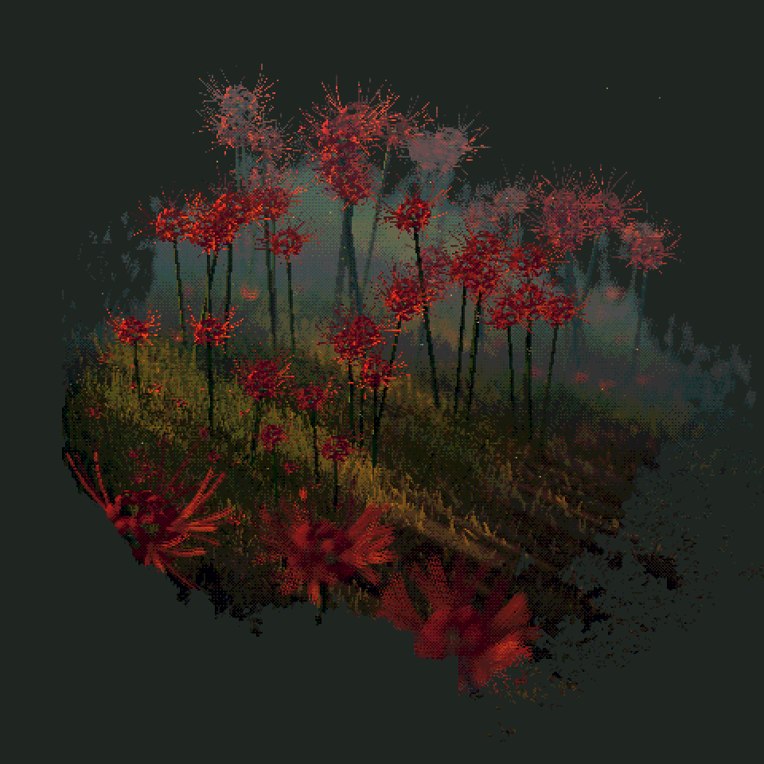
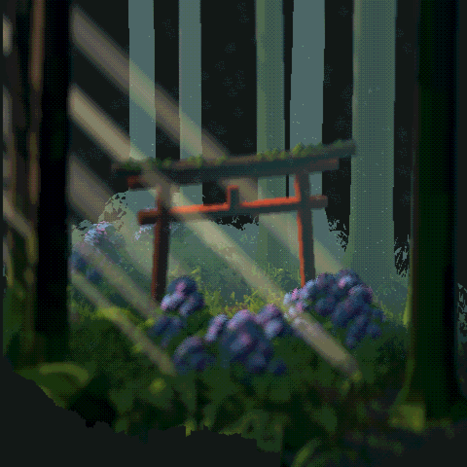
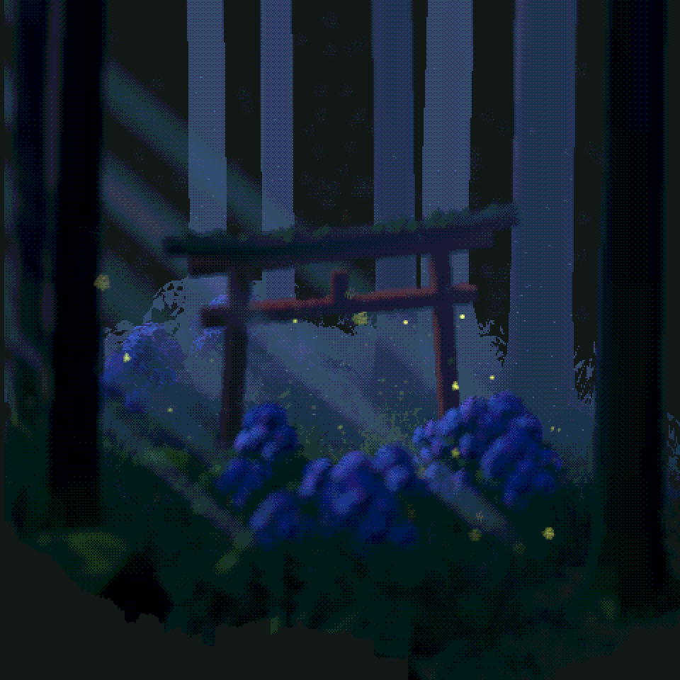
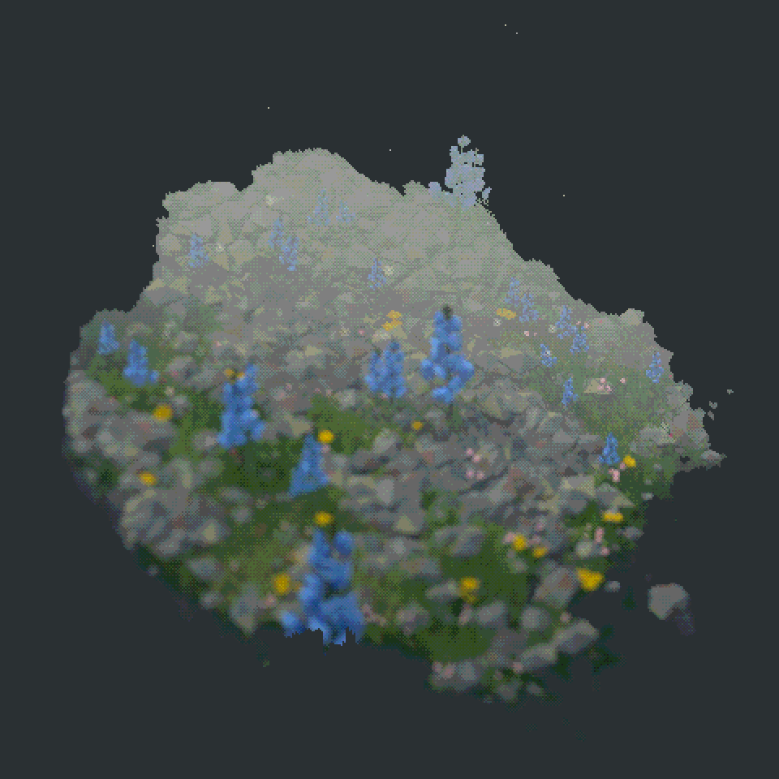
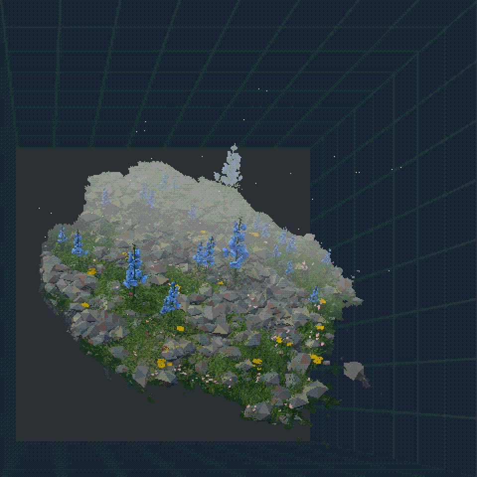
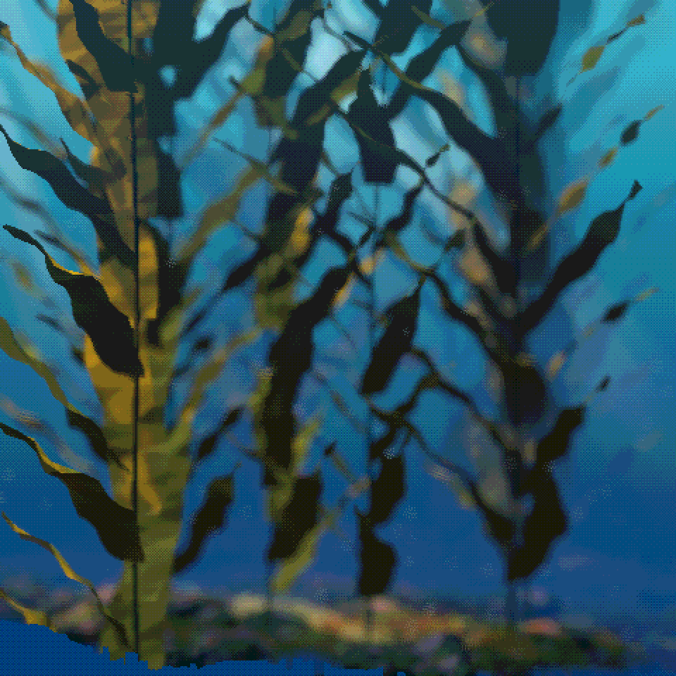

# ピクセルジオラマ

three.js で描いた 3D シーンを低解像度でレンダリングし、ディザをかけてドット絵風に見せる小さなジオラマ集です。
`index.html` の上部にあるプルダウンでシーンを切り替えられます。

| 彼岸花の野 | 森の神社 | 森の神社 · ホタルの夜 |
|:---:|:---:|:---:|
|  |  |  |
| `spider-lily/field.html` | `forest-shrine/shrine.html` | `forest-shrine/shrine.html?tod=fireflies` |

| ガレ場 · メコノプシス | ガレ場 · 裸眼3D | 海中のケルプの森 |
|:---:|:---:|:---:|
|  |  |  |
| `scree/scree.html` | `scree/peek.html`（ヘッドトラッキング） | `kelp/kelp.html` |

スクリーンショットは各シーンの既定設定のまま撮ったものです（裸眼3D は少し横からのぞいた視点）。実際には草や海藻が揺れ、光や霧が動きます。

## 動かし方

ES モジュールと `fetch` を使うので、`file://` では開けません。ローカルサーバーで開いてください。

```
python -m http.server 8000
```

ブラウザで `http://localhost:8000/` を開きます。three.js（unpkg）と、裸眼3D の顔認識（MediaPipe）は CDN から読み込むので、ネット接続が必要です。

## 操作

- 上部のプルダウン、◀ ▶ ボタン、PageUp / PageDown でシーン切り替え。
- 各シーン右上の「⚙ パネル」で、光・霧・被写界深度・配置のランダム化などを調整できます。設定はコピー／読み込みと 5 つのスロットに保存できます（保存先はブラウザのローカルストレージ）。
- 「● 録画 5秒」で 960×960 の MP4（使えない環境では WebM）を書き出します。
- 裸眼3D：「📷 ヘッドトラッキング開始」でインカメラから目の位置を推定し、画面を窓として奥の箱をのぞき込むように描画します。カメラなしでも画面をドラッグして試せます。カメラは https か localhost でのみ使えます。

## モデル

各シーンの `.glb` は numpy だけで書いた Python スクリプトで手続き生成しています（`make_*.py`）。

```
python forest-shrine/make_shrine_assets.py   # 鳥居・シダ
python forest-shrine/make_hydrangea.py       # アジサイ
python scree/make_meconopsis.py              # メコノプシス
python kelp/make_kelp.py                     # ジャイアントケルプ
python spider-lily/make_spider_lily.py       # 彼岸花
```

生成先はスクリプトと同じフォルダです（第 1 引数で変更可）。`scree/make_peek.py` は `scree.html` から裸眼3D 版の `peek.html` を作り直します。
